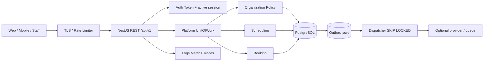

# BookCore — معماری نهایی طراحی 1.1

**سبک:** Modular Monolith + NestJS/TypeScript + PostgreSQL، یک تراکنش DB برای تصمیم قطعی ظرفیت؛ Worker Outbox اختیاری. این سند **نقشه پیاده‌سازی** است نه پیاده‌سازی/Benchmark.



## Dependency / ownership rules
`Identity → Platform`, `Organizations → Identity+Platform`, `Catalog → Organizations`, `Scheduling → Catalog+Organizations`, `Booking → read/lock Scheduling ports + Identity/Organizations`, `Reporting → read-model interfaces`, `Audit → append-only ports`. برای لغو کل Session، `SessionLifecycleCoordinator` در Application Composition Root و با `UoW` مشترک از `SchedulingTxPort` و `BookingTxPort` استفاده می‌کند، نه Import چرخه‌ای. اتصال به DB فقط Adapter و Providerهای محافظت‌شده؛ هیچ Controller/Worker حق SQL مستقیم تغییر Counter ندارد. `docs/domain/DOMAIN_MODEL_FA.md` قرارداد aggregateهاست.

## Atomicity و ترتیب قفل جهانی
1. Authenticate access token signature/claims بیرون TX (اشتباه Token → 401). در نوشتن، `auth_sessions FOR SHARE` برای session فعال و `users FOR SHARE` برای فعال بودن User؛ Access token کوتاه‌عمر جایگزین این خواندن نیست.
2. اگر Staff عمل می‌کند، `memberships FOR SHARE` برای عضو فعال و Role/Scope، پیش از خواندن داده Tenant؛ Customer خود را با identity و ownership مجاز می‌کنیم؛ role/customerId از body برای خودکار مجاز نیست. اگر تغییر نقش/لغو Membership، قفل مخالف UPDATE/`FOR UPDATE` لازم است. Tenant isolation default-deny.
3. برای عملیات write دارای Idempotency، `INSERT` رکورد `(tenant, actor, operation, key)` در TX؛ unique conflict requests یکسان را تا Commit winner منتظر می‌گذارد (lock_timeout محدود). پس از تشخیص hash، یا original cached response یا conflict بازگردانده می‌شود. کلید نه Tenant و نه Role ایجاد نمی‌کند؛ authorization ابتدا دوباره بررسی می‌شود.
4. Sessionهای هدف را به ترتیب `(tenant_id, session_id)` با `FOR UPDATE` قفل کنید؛ اگر یک Session است، همان یک سطر. سپس Bookingها با ترتیب `booking.id` و سپس Allocations با ترتیب `resource_id`؛ تفاوت ترتیب در هیچ workflow پذیرفته نیست. عملیات ساخت Session جدید ابتدا `Resource`ها به ترتیب UUID در TX lock می‌شوند؛ allocation exclusion آخرین مرز است.
5. `clock_timestamp()` بعد از قفل Session، ظرفیت/وضعیت/cutoff را ارزیابی می‌کند؛ Multi-query با time snapshot واحد **بعد از lock** تا پایان همان Use Case؛ صف‌های قفل ممکن است deadline را رد کنند.
6. تمام تغییرات aggregate + BookingEvent + audit_events + outbox + idempotency terminal response در همان Transaction؛ سپس Commit. Call بیرونی/شبکه در Transaction ممنوع.

`READ COMMITTED` پیش‌فرض: قفل Session نقطه serialization تغییر ظرفیت است. `SERIALIZABLE` پیش‌فرض نیست، چون همه writeهای حساس سطر مشترک Session دارند؛ مانع سوءاستفاده خارج از protocol باید DB privilege/invariant monitor باشد. در چند Session، fixed sorted locking و retry SQLSTATE `40P01`/`40001` با budget محدود. Exclusion violation `23P01` → 409 `RESOURCE_CONFLICT` (بدون Retry خودکار مگر سیاست تراکنش ایجاب کند). Unique violation `23505` برای booking → 409 `BOOKING_ALREADY_EXISTS`، خطای دیگر → 500 یا rollback. Lock timeout `55P03` و query timeouts → 503 retryable با trace. ابتدا log/metric، سپس بازگشت امن، بدون تقلید تأیید. پیشنهاد اولیه (باید در Spike کالیبره شود): `lock_timeout=2s`, `statement_timeout=5s`, `idle_in_transaction_session_timeout=10s` به صورت `SET LOCAL`; transaction retry حداکثر 2 بار (جمع 3 تلاش) با jitter کم و تنها برای Deadlock/Serialization، **فقط وقتی Commit وضعیت قطعیِ شکست دارد**. Unknown Commit outcome: هیچ Retry داخلی blind بدون Idempotency؛ همان Key را replay یا GET current resource.

### الگوریتم ایجاد رزرو
```
validate auth and shape outside transaction
BEGIN READ COMMITTED
  lock auth_session/user and membership(if staff)
  claim idempotency(scope, request_fingerprint)
  if existing: return saved response after auth, without mutation
  lock session FOR UPDATE
  verify tenant/status/time/customer active/capacity/unique effective booking
  if business rejection: save terminal 409/422 Problem response; COMMIT; send it
  INSERT booking(CONFIRMED, tenant, session, customer, actor)
  UPDATE sessions SET seats_committed = seats_committed+1, version=version+1
  INSERT booking_events, audit_events(if needed), outbox_events
  save terminal 201 response with stable booking ID
COMMIT
send 201 (only after acknowledged COMMIT)
```
`capacity=1, 100 distinct actors` → expected 1 confirmed and 99 `SESSION_FULL` provided no lock/timeouts under test; if timeout happens, safe 503 retryable not overbooking. `capacity=20` → expected 20 successful. این صرفاً انتظارات آزمون‌اند.

### لغو Booking / ظرفیت / لغو Session
- Cancel Booking: same auth/idempotency/session lock → booking lock → IF `CONFIRMED` THEN status CANCELLED/counter−1/event/outbox; IF already CANCELLED return 200 without mutation; other final states 409. concurrent cancels serial by Session lock.
- Capacity PATCH: Manager authorization → idempotency → lock Session → before start + status DRAFT/PUBLISHED → `newTotal >= seats_committed` → update total/version + audit/outbox. کاهش زیر تعهد 409 `CAPACITY_BELOW_COMMITTED`.
- Cancel Session: Manager auth → idempotency → lock Session → require before start/status DRAFT or PUBLISHED; lock effective bookings sorted → for each CONFIRMED mark CANCELLED + Event + Outbox → set count zero, Session CANCELLED, `resource_allocations.active=false`, Session audit/outbox. Cancel 15 bookings completely atomic. `ATTENDED/NO_SHOW` حضور پیش از شروع مجاز نیست، پس حالت نامعتبر reject و عیب‌یابی.
- Resource create/allocate: lock resources sorted; verify resource belongs tenant, active, correct branch/type; insert Session and Allocations with buffers, DB exclusion rejects overlaps. `DRAFT` holds allocations. On cancel disable, never hard delete.

## Idempotency: deterministic contract
**Scope:** tenant + authenticated actor + operation ID (method/path template/action) + key. Fingerprint = SHA-256 از `method` + normalized concrete path (orgId, sessionId, bookingId) + canonical JSON request + selected business headers (no auth/token). Canonical JSON spec RFC 8785 or fixed deterministic serializer verified in Spike؛ unknown fields rejected. UUIDv4 Key; TTL 24h پیشنهادی.

| وضعیت | رفتار دقیق | Cache |
|---|---|---|
| first request accepted | insert claim, domain mutation + complete response, COMMIT | 201/200 + body |
| domain rejection `SESSION_FULL`/`WINDOW_CLOSED` | **بدون domain mutation**، persist final problem response and COMMIT | yes، stable until cleanup |
| validation/auth failed before claim | 400/401/403/404 | no |
| same key/hash concurrent | waits on unique/row until winner commits, then replay; if timeout 503 `IDEMPOTENCY_IN_PROGRESS`+Retry-After | no new side effects |
| same key different hash | 409 `IDEMPOTENCY_KEY_REUSED` after auth | no mutation |
| DB rollback/exception | no committed idempotency result؛ respond retryable 503/500 according class | no |
| connection lost after sending COMMIT | unknown outcome, never 201 without ACK؛ client replays same key; committed response returned if present | lookup |
| expired/uncollected record | **design default:** replay stored terminal response as long as record physically exists (even after `expires_at`); cleanup makes old Key reusable, clients must use new Keys after 24h | stored until purge |
| after cleanup | key no longer deduplicates; domain unique still prevents 2 active bookings; cancel already cancelled no-op | eventual retention limit |

`IdempotencyRecord` with `PROCESSING` exists only transiently in uncommitted TX; protocol forbids committed PROCESSING. De-duplication to external provider is distinct outbox consumer duty. Replayed 201 represents original event, not a claim Booking is *currently* CONFIRMED; GET fetches current state. Business rejection stored inside successfully committed transaction, never rolled-back transaction.

## Timezone policy
Persistent `timestamptz` UTC instants; org IANA timezone as reference, plus `session.timezone_snapshot` for reproducibility. API accepts RFC3339 with numeric offset or `Z`; reject naive local date. For a chosen UTC instant, offset must match tenant IANA zone on that instant; mismatch 422 `INVALID_TIMEZONE_OFFSET`; nonexistent wall time cannot match a zone offset and is rejected; ambiguous local time can be disambiguated only by valid explicit offset. Use ISO/Gregorian internal date, Persian calendar only UI. Weekly hours anchored ISO weekday local 1–7; overnight intervals allowed with end_day_offset=1; exceptions expressed as absolute instants plus local calendar metadata. Validate the whole Session interval against both applicable branch and trainer hours, not just its start. A matching `CLOSED` always blocks; an audited `OPEN_OVERRIDE` may extend regular hours but never override a `CLOSED` exception. Reject conflicting overrides and partially covered intervals. Opening overrides require a nonempty Manager reason. The entire buffer-expanded resource allocation must also fit applicable availability or a legitimate OPEN_OVERRIDE. Room availability is covered by its branch schedule and exclusive allocation constraint. Creating/editing hours or exceptions serializes on their target Branch/Resource row to avoid conflicting concurrent weekly rules. Buffer checks apply to allocations across days/midnight; half-open `[start,end)` for both. Edge case now==start: no booking/cancel. Policy revisions do not retroactively cancel already published sessions.

## Outbox and reliability
Outbox insert inside TX; Dispatcher claims batch of available rows with `FOR UPDATE SKIP LOCKED`, sets lease and retries bounded. Crash after provider publish/before mark leads duplicates (at-least-once); consumer dedupes `event_id`. `published_at` means dispatcher handed to durable provider, **not user received message**. Optional notifications not activated in MVP; persist outbox for future export. OTel traceId, tenantId, sessionId, sanitized error `code`, db_lock_wait_seconds, outbox_age. Health/live independent; readiness checks vital DB access; network/provider outage cannot make false booking success.

## Design ADRs & technical spikes
`docs/architecture/ADR/` ثبت تصمیم‌های فردی؛ `docs/database/DATABASE_DESIGN_FA.md` schema دقیق؛ `docs/security/THREAT_MODEL_FA.md` مجوزها. Spikeهای الزام‌آور: SQL partial exclusion + `btree_gist`, raw SQL in ORM transactions, lock order vs membership revoke, actual migration/introspection, two-replica booking race, backup/restore; بدون اجرای Spike هیچ ادعای Production-ready وجود ندارد.

## Stable Error Taxonomy (RFC 9457 / API design)
Errors use `application/problem+json` with `type` URI-reference, `title`, HTTP `status`, application `code`, `traceId` and optional `retryable` without SQL details. `404` hides foreign Tenant object existence; for an authenticated caller who can see a Tenant but not perform an operation use 403. Representative, stable codes:

| HTTP | code | Meaning / retry |
|---|---|---|
| 400 | `REQUEST_VALIDATION_FAILED` | malformed JSON, query, forbidden field, unsupported sort; no automatic retry |
| 401 | `AUTHENTICATION_REQUIRED` | invalid/expired session/token |
| 403 | `TENANT_ACCESS_DENIED` | principal lacks visible Tenant role/function; not for foreign existence |
| 404 | `RESOURCE_NOT_FOUND` | missing or hidden cross-Tenant resource |
| 409 | `ORGANIZATION_SUSPENDED` | no new bookings/scheduling for suspended organization |
| 409 | `SESSION_FULL` | requested capacity unavailable |
| 409 | `BOOKING_ALREADY_EXISTS` | effective booking uniqueness |
| 409 | `SESSION_NOT_BOOKABLE` | Session draft, finished, cancelled or already started |
| 409 | `RESOURCE_CONFLICT` | PostgreSQL exclusion 23P01 |
| 409 | `IDEMPOTENCY_KEY_REUSED` | same scoped key, different normalized request |
| 409 | `INVALID_STATE_TRANSITION` | forbidden Session/Booking transition |
| 409 | `CAPACITY_BELOW_COMMITTED` | requested total less than currently committed |
| 409 | `SESSION_NOT_CANCELLABLE` | Session already started or terminal |
| 409 | `LAST_OWNER` | attempt to remove final Active Owner |
| 422 | `CANCELLATION_WINDOW_CLOSED` | Customer cancellation past cutoff |
| 422 | `INVALID_TIMEZONE_OFFSET` | RFC3339 offset not valid for Tenant IANA timezone on selected instant |
| 422 | `INVALID_SCHEDULE` | outside permitted hours/exception or missing required allocation |
| 413 | `PAYLOAD_TOO_LARGE` | byte limit exceeded before parsing |
| 429 | `RATE_LIMITED` | abuse / fair use, Retry-After when possible |
| 503 | `IDEMPOTENCY_IN_PROGRESS` | scoped key waiting on another uncommitted TX; same-key retry |
| 503 | `COMMIT_OUTCOME_UNKNOWN` | DB connection lost during COMMIT; **do not assume failure or success**; same-key retry |
| 503 | `DEPENDENCY_UNAVAILABLE` | DB unready/lock timeout, safe retry only with Key |

Not all endpoints can return every code. Production must document public `type` URI under a real documentation domain before release. `409` domain rejections may be stored as terminal idempotent responses; infrastructure 5xx are never recorded as terminal.

## API projection / security boundary (Phase 01 final correction)
External routing is strictly separated, not content-negotiated or authenticated-condition polymorphism: `/api/v1/public/organizations/{orgId}/sessions[/{sessionId}]` is anonymous, *published-only*, and serialized through a separate PublicSession allowlist DTO; `/api/v1/organizations/{orgId}/sessions[/{sessionId}]` is bearer+tenant staff membership required, projecting StaffSession only with Trainer assigned-session scope. Do not return StaffSession through a public controller and hope the client hides fields. Trainer may not call generic `GET /resources` because it returns internal resource linkage; personal calendar is assigned-session-only. Booking responses omit audit-only `createdByActorId` though its DB column remains required. Use restricted SQL projection or field allowlist mapping before JSON serialization. The `PublicSession` `status` can only be PUBLISHED; public detail of nonpublished record resolves 404. `GET /me` uses ACTIVE-only Membership query and returns `{user,memberships}` even when empty; revoked memberships require separate future staff/admin audit flow, not `/me`.

Temporal boundary: Session/exception **write input** validated with explicit RFC3339 offset matching IANA local-time policy, PostgreSQL persists UTC instants, and all API response time instants return canonical UTC `Z`. `createdAt`, `cancelledAt`, Event.at are server-generated instants and never compared against the tenant offset. `/health/ready` requires network isolation plus monitor API key, `/health/live` remains anonymous. See `docs/security/AUTHORIZATION_MATRIX.md` and OpenAPI.
