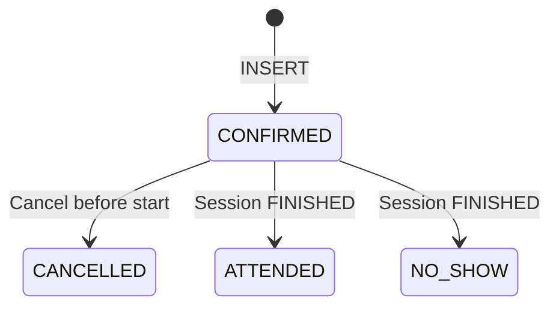

# ماشین وضعیت Booking — فاز ۰۷

| انتقال | پیش‌شرط و قفل | Counter | رویداد |
|---|---|---|---|
| none→CONFIRMED | User/Session فعال، `PUBLISHED`, `now < start`, ظرفیت آزاد؛ Session `FOR UPDATE` | +۱ | اولیه `(null,CONFIRMED)` |
| CONFIRMED→CANCELLED شخصی | مالک Booking، `PUBLISHED`, پیش از `start - cancellation_cutoff_min` | -۱ | دلیل مشتری یا `CUSTOMER_REQUEST` |
| CONFIRMED→CANCELLED کارمندی | OWNER/MANAGER/RECEPTIONIST، قبل از شروع، دلیل غیرخالی | -۱ | دلیل و Actor در Event/Audit |
| CONFIRMED→CANCELLED لغو جلسه | هماهنگ‌کننده Session فاز ۰۶؛ تمام Bookingهای مؤثر در یک TX | -۱ هر مورد، نتیجهٔ صفر | Event/Outbox برای هر Booking |
| CONFIRMED→ATTENDED / NO_SHOW | نقش کارکنان مجاز یا مربی همان Resource؛ Session `FINISHED` و `now >= end` | بدون تغییر | یک رویداد انتهایی |

`ATTENDED`, `NO_SHOW`, `CANCELLED` وضعیت‌های انتهایی هستند و تغییر مجدد آن‌ها ممنوع است. پایگاه داده با Guardهای `003/004` و بررسی زنجیرهٔ رویدادها از وضعیت انتهایی محافظت می‌کند. مشتری نمی‌تواند حضور خودش را ثبت کند. برای کاربر عادی، عبور از Cutoff نتیجهٔ `422 CANCELLATION_WINDOW_CLOSED` است؛ سایر انتقال‌های غیرمجاز 409 می‌دهند.
