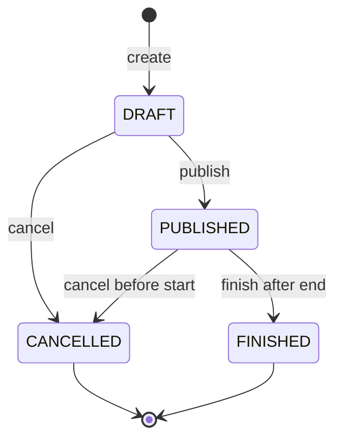

# BookCore — ماشین‌های وضعیت قطعی MVP

**پیش‌فرض ثابت:** Transaction UTC و clock_timestamp() در DB بعد از گرفتن قفل Session. خطاها RFC9457 و `code` ماشینی. همه تغییرات با Audit + Outbox همان TX. Session فقط قبل از شروع قابل لغو است؛ Finish فقط پس از پایان؛ attendance فقط روی Finished. حالت `ATTENDED/NO_SHOW` سابقه تاریخی را حفظ و Counter را کم نمی‌کند.

## Session

| Transition | Actor | Preconditions | Atomically changed | Errors |
|---|---|---|---|---|
| create→DRAFT | Owner/Manager | valid service, trainer, room, branch, schedule, no resource conflict | insert Session (counter=0), allocations active, outbox | 409 RESOURCE_CONFLICT,422 INVALID_SCHEDULE |
| DRAFT→PUBLISHED | Owner/Manager | now < start; active catalog; required allocations exist; hours valid | status, Audit, Outbox | 409 INVALID_STATE_TRANSITION,422 INVALID_SCHEDULE |
| DRAFT→CANCELLED | Owner/Manager | no bookings | status, allocations inactive, Audit, Outbox | 409 INVALID_STATE_TRANSITION |
| PUBLISHED→CANCELLED | Owner/Manager | now < start; bookings only CONFIRMED/CANCELLED | lock Session and confirmed Bookings; confirmed→CANCELLED with reason `SESSION_CANCELLED`; counter→0; inactive allocations; per-booking events, session event and outbox | 409 SESSION_NOT_CANCELLABLE, 503 LOCK_TIMEOUT |
| PUBLISHED→FINISHED | Owner/Manager or scheduler* | now >= end; not cancelled | status, Audit, Outbox; counter unchanged | 409 INVALID_STATE_TRANSITION |

*Automatic scheduler not required in MVP; Owner/Manager invokes finish endpoint. Scheduler authorization would require a separate audited service identity and is outside this phase.

Forbidden: CANCELLED/FINISHED→anything; PUBLISHED→DRAFT; Finish before end; cancellation after start. Modify capacity before start only for Draft/Published; `newCapacity >= seats_committed`. Time/trainer/room replacement when effective booking exists is forbidden. With zero bookings, modify Draft only; PUBLISHED resource/time edits are forbidden for transparency (cancel and recreate). Draft allocations block other Drafts until canceled; operations must release them explicitly.

## Booking

```mermaid
stateDiagram-v2
  [*] --> CONFIRMED: book before session starts
  CONFIRMED --> CANCELLED: customer/staff cancel; or session cancel
  CONFIRMED --> ATTENDED: attendance after FINISHED
  CONFIRMED --> NO_SHOW: absence after FINISHED
  CANCELLED --> [*]
  ATTENDED --> [*]
  NO_SHOW --> [*]
```

| Transition | Actor | Preconditions | Counter Δ | DB / audit | Error |
|---|---|---|---|---|---|
| none→CONFIRMED | customer self or authorized staff | User active, Organization ACTIVE, Session Published, now < start, capacity, not effective duplicate, actor scope | +1 | insert booking/event/outbox | 409 SESSION_FULL/BOOKING_ALREADY_EXISTS |
| CONFIRMED→CANCELLED self | customer==owner | session Published, now <= start - cutoff | -1 | update booking/cancel metadata/event/outbox | 422 CANCELLATION_WINDOW_CLOSED |
| CONFIRMED→CANCELLED staff | Owner/Manager/Receptionist | session Published, now < start, nonblank reason | -1 | same + actor different | 403/422 |
| CONFIRMED→CANCELLED session | Session Lifecycle Coordinator | session Published, now < start, reason | -1 each (bulk final 0) | per booking event/outbox, inactive alloc | 409 SESSION_NOT_CANCELLABLE |
| CONFIRMED→ATTENDED/NO_SHOW | Owner/Manager/Receptionist or assigned Trainer | session FINISHED, now >= end, authorization | 0 | update status, event, outbox | 409 INVALID_STATE_TRANSITION |

CANCELLED→CONFIRMED never; rebook is a new UUID. ATTENDED/NO_SHOW are final in MVP; corrections use a future Audited Amendment workflow. If cancellation repeats with a **different** Key and booking is CANCELLED, return 200 with current status and `alreadyCancelled=true`; do not increment/decrement, do not add extra BookingCancelled event. Replay with **same** key returns cached original response exactly. A request to cancel ATTENDED/NO_SHOW returns 409. Booking may remain CONFIRMED after FINISHED until attendance; no further booking/cancel possible.

## Concurrency walkthroughs
**A — 15 confirmed, Manager cancels Session:** authorize + lock Session, lock bookings sorted ID; 15 state changes + 15 booking_events + 15 BookingCancelled outbox events + one SessionCancelled; `seats_committed=0`; allocations `active=false`; Session CANCELLED; all changes Commit together or none. After cancellation, anonymous public GET Session returns 404 (it is no longer PUBLISHED); authorized tenant staff GET Session returns CANCELLED, while the customer sees CANCELLED via their own `GET /organizations/{orgId}/bookings/me` (the Booking record remains intact). Dispatcher failure does not undo cancellation. No implicit deletion.

**B — دو لغو:** هر دو lock Session به ترتیب؛ اول CONFIRMED→CANCELLED و counter-1، دوم می‌بیند CANCELLED و فقط نتیجهٔ alreadyCancelled می‌دهد؛ صفر یا منفی نمی‌شود.

**C — حضور:** only when Session FINISHED; Counter fixed; گزارش total committed historical incl attendance/no-show. Session CANCELLED امکان attendance ندارد.

**D — بازبرنامه‌ریزی:** Any PATCH time or trainer on Published rejected. If future Published with Bookings needs schedule change, authorized staff cancels with reason, communicates new Session and requests customers to rebook; no automatic transfer and no claim of retaining seats.

**E — کاهش ظرفیت هم‌زمان:** lock Session مشترک؛ اگر booking قبل از update commit شود، update new capacity < committed رد؛ اگر capacity update اول commit شود، reservation بعدی against updated total اعتبارسنجی می‌شود. `CHECK` لایه ثانویه است.

## State vs API mapping
`POST sessions` DRAFT؛ `POST sessions/{id}/publish` PUBLISHED؛ `POST sessions/{id}/cancel` CANCELLED؛ `POST sessions/{id}/finish` FINISHED؛ `PATCH sessions/{id}/capacity` unchanged status؛ `POST sessions/{id}/bookings` CONFIRMED؛ `POST bookings/{id}/cancel` CANCELLED؛ `POST bookings/{id}/attendance` ATTENDED or NO_SHOW. برای status و response codes قرارداد `docs/api/openapi.yaml` مرجع است.

## Published public read behavior and DTO isolation
`PublicSession.status` در OpenAPI تنها `PUBLISHED` است؛ public list فقط upcoming PUBLISHED را بازمی‌گرداند و public detail فقط PUBLISHED قابل مشاهده را، در غیر این صورت 404. وضعیت‌های `DRAFT`, `CANCELLED`, `FINISHED` فقط در `StaffSession` از مسیر authenticated staff دیده می‌شوند. این Read Projection هیچ Transition جدیدی ایجاد نمی‌کند و با Transition جدول بالا مغایرت ندارد. `GET /me` حاوی عضویت ACTIVE کارمندی است، نه حالت جدید Booking. UTC `Z` output است و Session creation offset validation فقط در زمان نوشتن اعمال می‌شود.
