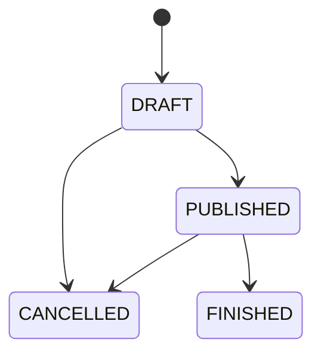

# ماشین وضعیت Session — Phase 06

| وضعیت مبدأ | وضعیت مقصد | پیش‌شرط زمانی | عملیات DB / پیامد |
|---|---|---|---|
| DRAFT | PUBLISHED | اکنونِ PostgreSQL قبل از شروع | بازبینی منابع، ساعات کاری، عضو TRAINER، Allocation؛ تغییر status/version؛ Audit/Outbox |
| DRAFT | CANCELLED | قبل از شروع | لغو Session، آزادسازی Allocation و تاریخچه؛ Audit/Outbox |
| PUBLISHED | CANCELLED | قبل از شروع | لغو **تمام** CONFIRMEDها، ۰شدن Counter، رویداد تک‌تک Bookingها، آزادسازی Resource؛ Audit/Outbox |
| PUBLISHED | FINISHED | اکنونِ PostgreSQL >= end_at | تغییر status/version بدون ثبت Attendance؛ Audit/Outbox |
| CANCELLED / FINISHED | هر وضعیت | هر زمان | رد با `INVALID_STATE_TRANSITION` |

### لغو گروهی
`POST /sessions/{id}/cancel` کلید UUID `Idempotency-Key` اجباری دارد. Claim و Final Response در یک تراکنش ذخیره می‌شوند. تکرار همان Payload و کلید همان پاسخ را بدون Side Effect بازمی‌گرداند؛ Payload متفاوت 409 برمی‌گرداند. 4xx حاصل از وضعیت نامعتبر یا Session ناموجود نیز بعد از بررسی احراز هویت به صورت FINAL ذخیره می‌شود. خطای SQL یا شکست COMMIT نامعلوم نباید به پاسخ قطعی موفق تبدیل شود؛ در مورد outcome نامعلوم، Retry باید با همان کلید انجام شود.

### ظرفیت
`PATCH /capacity` پس از قفل ردیف Session، مقدار جدید را با Counter موجود مقایسه می‌کند؛ کمترشدن از `seats_committed` ممنوع است. هیچ بازنشانی Counter هنگام تغییر ظرفیت رخ نمی‌دهد. مجوز OWNER/MANAGER باید مجدداً داخل Transaction بررسی شود.

### محدودیت‌های اثبات
صحت تریگرهای deferred، اتصال یکسان تراکنش و رقابت چندپردازشی در محیط حاضر `NOT VERIFIED` است. Retrying اثرات غیرIdempotent قبل از COMMIT و لزوم Checksum Ledger باید با PostgreSQL 17 آزمایش شود.
