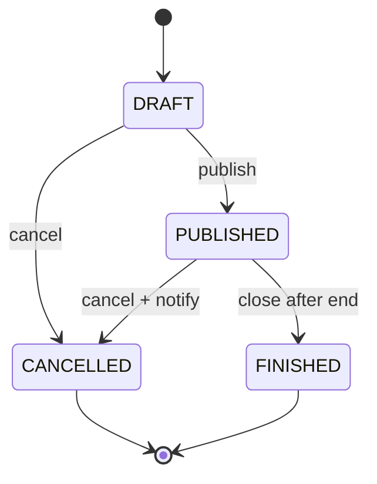
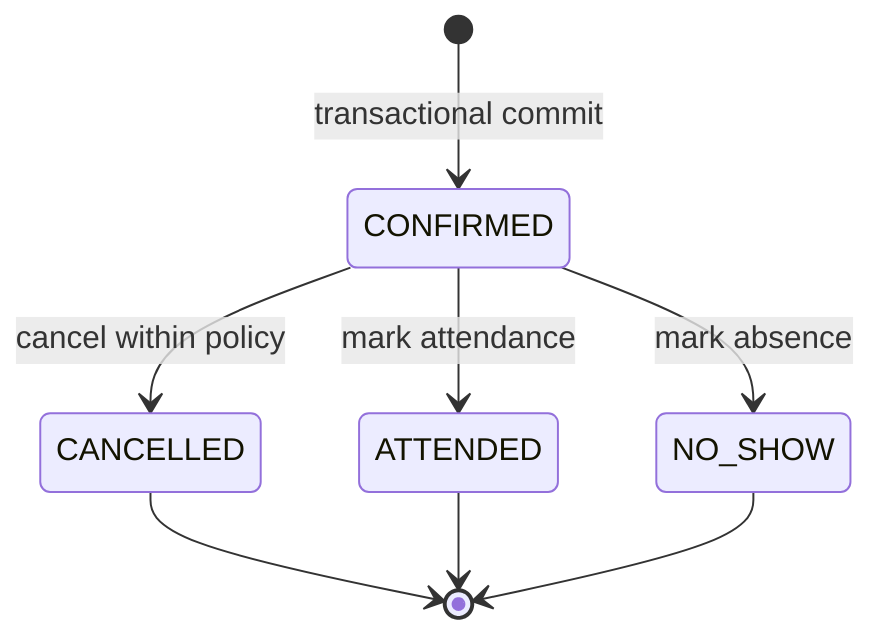
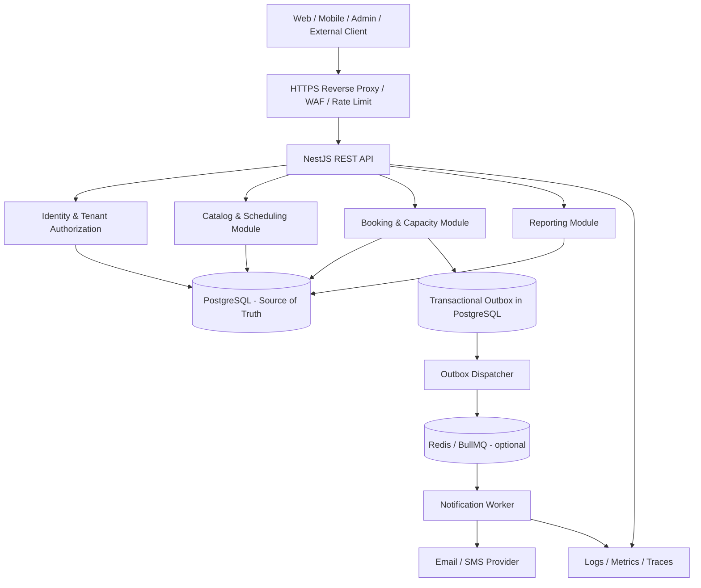
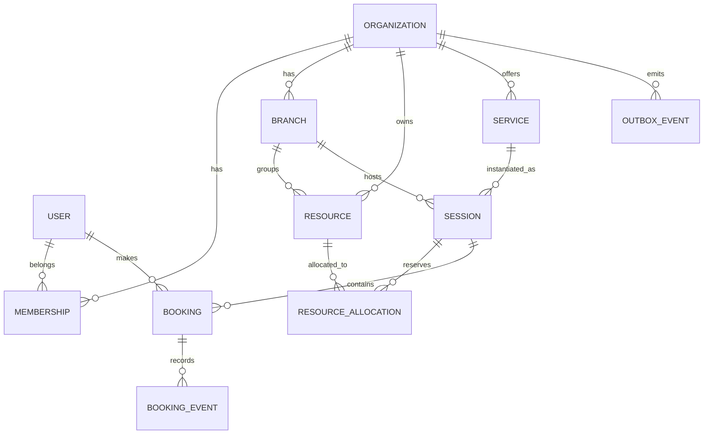
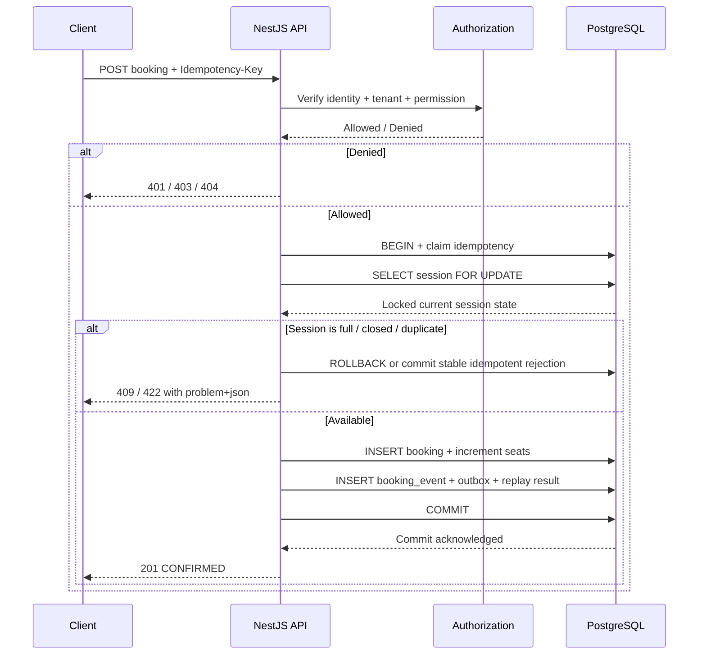

# BookCore — Software Engineering Blueprint

**شناسه سند:** BC-SENG-001  
**نسخه:** 1.0 — Design Baseline / پیش از پیاده‌سازی  
**تاریخ:** 2026-11-21  
**وضعیت:** پیشنهاد مهندسی برای بازبینی و اعتبارسنجی؛ هیچ بخشی از این سند ادعای پیاده‌سازی یا تست موفق ندارد.

---

## 0. خلاصه مدیریتی و اصول تصمیم‌گیری

**BookCore** یک موتور رزرو و مدیریت ظرفیت با رویکرد API-first برای باشگاه‌های ورزشی، مربیان خصوصی و کلاس‌های ظرفیت‌دار است. هدف این سند تعریف یک سیستم واقعاً قابل ساخت و قابل استفاده است، نه یک فهرست بلند از تکنولوژی‌ها.

**اصل معماری:** PostgreSQL مرجع نهایی حقیقت رزرو است؛ API/Redis/Queue تنها مصرف‌کننده یا شتاب‌دهنده‌اند و هرگز تصمیم قطعی اشغال ظرفیت را به‌تنهایی اتخاذ نمی‌کنند.

**شش اصل غیرقابل مذاکره:** (۱) جلوگیری از Overbooking در حضور درخواست هم‌زمان؛ (۲) جداسازی اطلاعات سازمان‌ها؛ (۳) کنترل تداخل مربی/سالن در دیتابیس؛ (۴) تغییر وضعیت قابل ردیابی و بدون پاک‌کردن تاریخچه؛ (۵) قرارداد API و خطای قابل پیش‌بینی؛ (۶) تست قابل بازتولید قبل از هر انتشار.

**محدوده MVP:** رزرو جلسات از پیش ایجادشده به‌ازای هر مشتری یک صندلی، بدون پرداخت و بدون رزرو موقت؛ ایجاد/انتشار جلسات، ظرفیت، لغو، حضور/غیبت، تقویم و مدیریت نقش‌های سازمان. این محدوده برای اثبات صحت بنیادی BookCore انتخاب شده است.

**خارج از MVP:** پرداخت اینترنتی/استرداد، لیست انتظار اتوماتیک، رزرو گروهی، تکرار تقویم خودکار، تخصیص پیچیده تجهیز مشترک، محاسبه قیمت پویا، پیامک واقعی و اشتراک پولی SaaS. رابط مدیریتی حداقلی اختیاری است؛ هسته API-first است.

**فرضیات نیازمند تأیید مشتری:** بازار اولیه ایران، استفاده در باشگاه‌های تک‌شعبه یا چندشعبه، هر رزرو برای یک نفر و یک جلسه، تعداد مربیان محدود، نیاز به تاریخ شمسی در UI اما ذخیره زمانی استاندارد، بدون پرداخت در اولین پایلوت، لغو توسط مشتری تا ۲ ساعت پیش از شروع (قابل تنظیم برای هر سازمان). این‌ها واقعیت بازار اثبات‌شده نیستند.

---

## 1. صورت مسئله، ذی‌نفعان و ارزش پیشنهادی

### 1.1 مسئله

مدیریت دستی رزرو در پیام‌رسان، تماس و اکسل موجب رزرو هم‌زمان یک ظرفیت، تداخل مربی، اشتباه زمان، عدم ثبت لغو و نبود گزارش دقیق می‌شود. BookCore باید با یک موتور مرکزی قابل اتکا، این ناهماهنگی‌ها را از بین ببرد و قابلیت اتصال به هر وب‌سایت و اپلیکیشنی را داشته باشد.

### 1.2 ذی‌نفعان

| ذی‌نفع | هدف | دغدغه اصلی |
|---|---|---|
| مالک سازمان | مدیریت چند شعبه/مربی و گزارش | هزینه، دسترسی و اعتمادپذیری |
| پذیرش/مدیر | مدیریت برنامه و رزرو | سرعت و جلوگیری از اشتباه |
| مربی | دیدن تقویم و ثبت حضور | تداخل و تغییرات دیرهنگام |
| مشتری | مشاهده ظرفیت واقعی و رزرو ساده | اطمینان از رزرو و سیاست لغو شفاف |
| پشتیبانی پلتفرم | ردیابی خطا بدون افشای داده | حریم خصوصی و قابلیت عیب‌یابی |
| مهندس عملیات | استقرار و بازیابی مطمئن | Backup، Alert، Rollback |

### 1.3 شاخص‌های کسب‌وکاری پیشنهادی (Targets، نه نتایج مشاهده‌شده)

- نرخ رزرو موفق به درخواست معتبر و دارای ظرفیت؛
- صفر مورد Overbooking تأییدشده در آزمون‌های رقابتی؛
- زمان انجام رزرو برای کاربر عادی در شرایط پایلوت؛
- کاهش اختلافات برنامه‌ریزی گزارش‌شده توسط پذیرش؛
- درصد مربیان و کلاس‌هایی که برنامه آنها در سیستم مدیریت می‌شود؛
- درصد لغوهای ثبت‌شده همراه با دلیل، و اختلاف تعداد حضور ثبت‌شده با واقعیت.

قبل از تعیین KPI عددی کسب‌وکار باید با ۲–۳ مدیر باشگاه مصاحبه و وضعیت پایه اندازه‌گیری شود.

---

## 2. نیازمندی‌ها و اولویت‌بندی

### 2.1 نیازمندی‌های کاربردی الزامی MVP

| شناسه | نیازمندی | معیار پذیرش سطح بالا |
|---|---|---|
| FR-01 | ثبت/ورود و مدیریت نشست امن | مسیرهای محافظت‌شده بدون هویت معتبر 401 برگردانند |
| FR-02 | ایجاد سازمان، شعبه و عضویت | هر درخواست سازمانی عضویت و مجوز معتبر را بررسی کند |
| FR-03 | مدیریت نقش مالک، مدیر، پذیرش، مربی، مشتری | عدم امکان ارتقای نقش توسط خود کاربر |
| FR-04 | تعریف مربی و منابع رزرو اختصاصی | منبع متعلق به سازمان باشد و چرخه عمر مشخص داشته باشد |
| FR-05 | ثبت ساعت کاری، تعطیلی و استثنا | جلسه بیرون بازه مجاز ایجاد نشود مگر با Override مجاز و ثبت علت |
| FR-06 | ایجاد، انتشار و لغو جلسه | هر جلسه بازه زمانی، مربی، ظرفیت و وضعیت معتبر داشته باشد |
| FR-07 | جلوگیری از تداخل تخصیص منبع | بازه‌های هم‌پوشان یک منبع اختصاصی را دیتابیس رد کند |
| FR-08 | نمایش موجودی ظرفیت | API مقدار قابل نمایش را از داده معتبر محاسبه کند؛ نمایش، تضمین رزرو نیست |
| FR-09 | ثبت رزرو یک‌نفره اتمیک | در رقابت، تعداد رزروهای معتبر از ظرفیت نگذرد |
| FR-10 | جلوگیری از رزرو تکراری/Retry | Idempotency و Constraintهای دیتابیس فعال باشند |
| FR-11 | لغو رزرو با سیاست مشخص | لغو تکراری وضعیت را تخریب نکند؛ ظرفیت صحیح آزاد شود |
| FR-12 | ثبت حضور، غیبت و رویداد وضعیت | هر تغییر با actor، زمان و علت قابل ردیابی باشد |
| FR-13 | تقویم مربی و سازمان | فیلتر دقیق بازه، مربی و شعبه با Pagination |
| FR-14 | خروجی گزارش اولیه | گزارش تعداد جلسات، رزروها، لغو و حضور بر اساس بازه |
| FR-15 | ثبت رویدادهای دامنه و Outbox | تغییر حیاتی و ثبت رویداد در یک Transaction انجام شوند |
| FR-16 | سلامت سرویس و عملیات پشتیبان | لایونس/ردینس، لاگ ساختارمند و بکاپ آزمایش‌شده |

### 2.2 نیازمندی‌های «بعد از اثبات موتور»

| مرحله | نیازمندی |
|---|---|
| V1.1 | اعلان ایمیل/پیامک با Queue و Retry و قالب‌بندی |
| V1.2 | Waitlist با FIFO و پیشنهاد زمان‌دار ظرفیت آزادشده |
| V1.3 | رزرو موقت (Hold)، درگاه پرداخت و تایید Webhook، استرداد |
| V1.4 | قالب تکرار هفتگی/ماهانه، تعطیلی‌های ویژه، چندمربی/چندمنبع |
| V2 | اشتراک SaaS، صورتحساب، گزارش مالی، API Keys سازمانی، وب‌هوک خروجی |

### 2.3 نیازمندی‌های غیرکاربردی (اهداف طراحی، نه تضمین عملکرد)

| شناسه | بُعد | معیار هدف و روش سنجش |
|---|---|---|
| NFR-01 | درستی | صفر Overbooking در ماتریس تست رقابتی و آزمون تغییر ظرفیت |
| NFR-02 | پاسخ‌دهی | هدف آزمایشگاهی اولیه p95 زیر ۳۰۰ms برای POST رزرو، بدون احتساب اینترنت، در حجم بار تعریف‌شده |
| NFR-03 | پایداری | هدف SLO پس از پایلوت: 99.9% دسترس‌پذیری ماهانه؛ وابسته به زیرساخت |
| NFR-04 | بازیابی | هدف طراحی: RPO ≤ ۱۵ دقیقه و RTO ≤ ۶۰ دقیقه؛ با Restore Drill باید اثبات شود |
| NFR-05 | امنیت | MFA برای نقش‌های حساس در استقرار واقعی؛ تست BOLA، BFLA و Tenant Isolation |
| NFR-06 | نگهداشت‌پذیری | پوشش معنی‌دار شاخه‌های حیاتی؛ CI اجباری، ADR، قرارداد OpenAPI |
| NFR-07 | قابلیت مشاهده | Trace ID، لاگ JSON، Metrics/Alerts و شواهد وقوع خطا |
| NFR-08 | سازگاری زمانی | منطقه زمانی IANA هر سازمان، ذخیره UTC، آزمون DST |
| NFR-09 | دسترس‌پذیری داده | بکاپ رمزنگاری‌شده، اصل حداقل دسترسی و آزمون بازگردانی |
| NFR-10 | توسعه‌پذیری | افزودن پرداخت و اعلان بدون تغییر بنیادین مدل رزرو MVP |

برای NFR-02 باید دستگاه تست، نسخه DB، تعداد مشتری، حجم داده، اندازه pool و سناریوی دقیق تعیین شوند؛ مقدار هدف «نتیجه تست» نیست.

---

## 3. قوانین دامنه (Domain Invariants)

**INV-01** هر جلسه دارای `capacity_total ≥ 1` و `0 ≤ seats_committed ≤ capacity_total` است.

**INV-02** `seats_committed` فقط رزروهای مؤثر را می‌شمارد: `CONFIRMED`، `ATTENDED`، `NO_SHOW`؛ رزرو لغوشده سهمی ندارد. تبدیل `CONFIRMED` به `ATTENDED` یا `NO_SHOW` شمارنده را تغییر نمی‌دهد.

**INV-03** تغییر تعداد صندلی‌های متعهدشده و ایجاد/لغو رکورد رزرو باید در یک تراکنش DB انجام شود. در صورت شکست، همه تغییرات Rollback می‌شوند.

**INV-04** هر مشتری حداکثر یک رزرو مؤثر برای یک جلسه دارد؛ یکتایی با Partial Unique Index در دیتابیس پشتیبانی می‌شود.

**INV-05** دو تخصیص فعال به یک **منبع اختصاصی** (مربی یا سالن انحصاری) در زمان هم‌پوشان نمی‌توانند وجود داشته باشند. بازه‌ها `[start,end)` هستند؛ ساعت پایان یک جلسه می‌تواند ساعت شروع بعدی باشد. Buffer بین جلسات باید در بازه تخصیص لحاظ شود.

**INV-06** مشتری تنها جلسه `PUBLISHED` و قابل رزرو در زمان فعلی را رزرو می‌کند؛ جلسه گذشته، لغوشده یا بسته‌شده قابل رزرو نیست.

**INV-07** جلسه‌ای با رزرو مؤثر، نباید با ویرایش مستقیم بازه/مربی/ظرفیت به حالت ناسازگار برسد. تغییرات حساس با عملیات Reschedule و سیاست مشخص انجام می‌شوند؛ کاهش ظرفیت زیر مقدار متعهد ممنوع است.

**INV-08** لغو رزرو از سوی مشتری فقط پیش از حد مجاز سازمان ممکن است. لغو مدیریتی خارج از این بازه با دلیل و Audit ثبت می‌شود.

**INV-09** همه داده‌های سازمانی `tenant_id` معتبر دارند؛ اتصال مرجع بین دو سازمان در سطح برنامه و تا حد ممکن با Foreign Key مرکب رد می‌شود.

**INV-10** تایید HTTP به‌معنی قطعی شدن تغییرات تراکنش است؛ ارسال اعلان خارجی جزو Commit رزرو نیست.

**INV-11** دو درخواست با Idempotency-Key یکسان و Body یکسان نباید دو رزرو بسازند. استفاده مجدد از کلید با Payload متفاوت باید پاسخ خطای قابل تشخیص بدهد.

**INV-12** هیچ عملیات دامنه‌ای نباید رویدادهای مهم رزرو را به‌صورت بدون ردپا حذف کند. Delete سخت برای Booking ممنوع؛ وضعیت‌گذاری و Audit استفاده می‌شود.

**INV-13** ساعت معتبر برای تصمیم ظرفیت و Deadline، زمان معتبر دیتابیس است. Timezone صرفاً برای محاسبه تقویم و نمایش تبدیل می‌شود.

**INV-14** ظرفیت خالی نمایش‌داده‌شده در GET، حق انحصاری ایجاد نمی‌کند؛ تنها تراکنش POST رزرو نتیجه قطعی را تعیین می‌کند.

---

## 4. مدل دامنه و گردش‌های اصلی

### 4.1 مفاهیم

- **Tenant/Organization:** مرز مالکیت داده و تنظیمات کسب‌وکار.
- **Branch:** شعبه یا محل خدمت.
- **Identity/User:** حساب جهانی؛ یک کاربر می‌تواند در چند سازمان عضویت داشته باشد.
- **Membership:** پیوند User به Organization همراه با نقش معتبر.
- **Resource:** موجودیت اختصاصی قابل زمان‌بندی؛ مانند مربی یا سالن در MVP.
- **Service:** نوع خدمت مانند «کلاس بدنسازی نیم‌ساعته» با مدت پیش‌فرض و تنظیمات.
- **Session:** وقوع واقعی یک خدمت در بازه ثابت با ظرفیت محدود، مربی و وضعیت مشخص.
- **ResourceAllocation:** اشغال فعال منبع در بازه زمانی جلسه؛ یک رکورد به‌ازای هر منبع موردنیاز.
- **Booking:** مشارکت یک مشتری در یک Session؛ بدون پرداخت و Hold در MVP.
- **BookingEvent:** تاریخچه تغییر وضعیت قابل ممیزی و قابل ردیابی.
- **IdempotencyRecord:** ثبت نتیجه قطعی درخواست نوشتنی برای Replay ایمن.
- **OutboxEvent:** پیام قابل انتشار که در همان تراکنش تغییر دامنه ثبت می‌شود.

**نکته:** `Session` با `Booking` فرق دارد: یک جلسه گروهی می‌تواند ۲۰ صندلی و ۲۰ رزرو داشته باشد؛ مربی/سالن فقط یک مرتبه برای کل جلسه اشغال می‌شود.

### 4.2 ماشین وضعیت Session



### 4.3 ماشین وضعیت Booking



برای MVP تغییر `CANCELLED → CONFIRMED` ممنوع است؛ رزرو مجدد رکورد جدید با ID جدید می‌سازد. تغییر وضعیت پس از پایان جلسه فقط توسط نقش مجاز و با دلیل ثبت می‌شود.

### 4.4 گردش ساخت جلسه

1. مدیر مجاز درخواست ایجاد Session با زمان UTC یا زمان محلی همراه با Timezone مشخص می‌دهد.
2. سیستم عضویت، صلاحیت مربی، شعبه، ساعت کاری، استثناها و ظرفیت را بررسی می‌کند.
3. در Transaction، Session و تمام `ResourceAllocation`های لازم ایجاد می‌شوند.
4. DB به‌وسیله Exclusion Constraint، تداخل قطعی یک منبع اختصاصی را رد می‌کند.
5. Event در Outbox درج و Transaction Commit می‌شود.
6. انتشار جلسه فرآیند جداگانه و مجاز است؛ جلسه Draft به مشتری نمایش داده نمی‌شود.

### 4.5 گردش ثبت رزرو

1. دریافت درخواست احراز‌شده با `Idempotency-Key`.
2. بررسی عضویت/مجوز و تعلق Session به Organization.
3. آغاز Transaction، Claim کردن کلید Idempotency با یکتایی و تشخیص Payload.
4. قفل کردن سطر Session (`SELECT ... FOR UPDATE`)، بررسی وضعیت، زمان و ظرفیت.
5. بررسی عدم رزرو مؤثر تکراری؛ محدودیت یکتایی دیتابیس پشتیبان این بررسی است.
6. افزایش اتمیک `seats_committed` و ایجاد Booking و BookingEvent.
7. درج OutboxEvent و ثبت نتیجه قابل Replay برای همان Idempotency-Key.
8. Commit و پاسخ 201. در صورت نبود ظرفیت، 409 قابل پیش‌بینی بازمی‌گردد؛ DB ناسازگار نمی‌شود.

برای رقابت‌های هم‌زمان، قفل روی سطر Session درون تراکنش باعث سریالی شدن تغییر ظرفیت **همان جلسه** می‌شود. PostgreSQL رفتار قفل‌های سطری را مستند کرده است. اجرای بدون Transaction یا یک `SELECT count(*)` مستقل کافی نیست.

### 4.6 گردش لغو رزرو

- همان اصول Tenant Authorization و Idempotency اعمال می‌شود.
- سطر Session و Booking در ترتیب قفل یکسان قفل می‌شوند تا خطر Deadlock کاهش یابد.
- اگر رزرو `CONFIRMED` و لغو مجاز بود، وضعیت `CANCELLED` و شمارنده ظرفیت به‌صورت اتمیک به‌روزرسانی می‌شود.
- لغو تکراری همان نتیجه قبلی را به‌صورت مستند برمی‌گرداند؛ هر بار ظرفیت دوباره آزاد نمی‌شود.
- رویداد لغو در Outbox قرار می‌گیرد؛ اعلان بیرونی بعداً ارسال می‌شود.

### 4.7 بازبرنامه‌ریزی

در MVP تغییر زمان جلسه‌ای که رزرو دارد مسدود است یا عملیات «لغو و ایجاد جلسه جدید با تایید مدیر» انجام می‌شود. انتقال خودکار رزروهای کاربران با قفل‌گذاری دو Session و کنترل ظرفیت دوطرفه برای فاز بعد طراحی شده است. تغییر مستقیم Session به شکلی که باعث تداخل یا نقض تعهد مشتری شود ممنوع است.

---

## 5. مدل داده پیشنهادی (Logical Data Model)

| جدول | ستون‌های کلیدی | قیدها و نکات |
|---|---|---|
| `users` | id, email/phone, credential_ref, status | هویت جهانی؛ داده حساس محدود |
| `organizations` | id, name, timezone, cancellation_cutoff_min, status | Timezone معتبر IANA |
| `branches` | id, tenant_id, name, address | FK مرکب برای عدم ارتباط بین سازمان‌ها |
| `memberships` | tenant_id, user_id, role, status | Unique(tenant_id,user_id) |
| `resources` | id, tenant_id, branch_id, type, display_name, active | مربی و سالن انحصاری؛ Source of schedule allocations |
| `services` | id, tenant_id, title, duration_min, active | تعریف نوع خدمت مستقل از رخداد |
| `business_hours` | id, tenant_id, resource_id, weekday, start_local, end_local | قوانین تقویم محلی |
| `schedule_exceptions` | id, tenant_id, resource_id, local_date/interval, type | مرخصی/تعطیلی و Override |
| `sessions` | id, tenant_id, branch_id, service_id, start_at, end_at, status, capacity_total, seats_committed, version | Check capacity و start<end؛ ایندکس تقویم |
| `resource_allocations` | id, tenant_id, session_id, resource_id, start_at, end_at, active | EXCLUDE برای هم‌پوشانی منابع فعال |
| `bookings` | id, tenant_id, session_id, customer_id, status, created_at, cancelled_at | Partial unique روی رزرو مؤثر |
| `booking_events` | id, tenant_id, booking_id, from_status, to_status, actor_id, reason, at | Append-only در سطح API |
| `idempotency_records` | tenant_id, actor_id, operation, key, request_hash, outcome, expires_at | یکتایی، TTL/Retention، ثبت امن پاسخ |
| `outbox_events` | id, tenant_id, aggregate_id, type, payload, created_at, processed_at, attempts | تحویل Async و Consumer idempotent |

### 5.1 محدودیت‌های دیتابیسی ضروری

- `CHECK (capacity_total > 0 AND seats_committed BETWEEN 0 AND capacity_total)`.
- Partial Unique Index بر `(tenant_id,session_id,customer_id)` برای Statusهای `CONFIRMED`, `ATTENDED`, `NO_SHOW`.
- Foreign Key مرکب سازمانی در روابط حساس. در صورت استفاده از UUID سراسری همچنان Tenant Scope اعمال شود.
- GiST Exclusion Constraint با `btree_gist` برای `(tenant_id, resource_id, tstzrange(start_at,end_at,'[)'))` روی `resource_allocations` با `active=true`.
- ایندکس روی `(tenant_id, start_at)` و `(tenant_id, session_id, status)` متناسب با Queryهای واقعی.
- `ON DELETE CASCADE` در سوابق اصلی Booking/Audit نباید به حذف تاریخچه حساس منجر شود.

**نکته ORM:** برخی امکانات PostgreSQL از جمله Exclusion Constraints ممکن است نیازمند SQL Migration سفارشی باشند. با Prisma یا Drizzle، Migration باید شامل SQL قابل بررسی و تست باشد؛ به تعریف ORM به‌تنهایی برای تضمین عدم تداخل اکتفا نشود.

### 5.2 مدل ذخیره زمان

- `start_at`,`end_at`: `timestamptz` با معنای UTC؛ طول بازه بزرگ‌تر از صفر.
- `organizations.timezone`: مقدار IANA مانند `Asia/Tehran`؛ تقویم شمسی صرفاً در نمایش/ورودی تبدیل می‌شود.
- قاعده زمان محلی مبهم یا ناموجود هنگام تغییر ساعت باید صریح و تست‌شده باشد؛ برای MVP ترجیحاً زمان ناموجود رد شود و زمان مبهم نیازمند Offset مشخص باشد.
- بافر آماده‌سازی/نظافت به بازه `resource_allocations` اضافه می‌شود، نه بازه حضور مشتری در Session.
- مقایسه دو جلسه مجاور با `[start,end)`، نه بازه بسته.

---

## 6. طرح معماری

### 6.1 انتخاب اصلی

**Modular Monolith با ساختار Domain-Oriented**: یک Backend API واحد، یک PostgreSQL، Worker جداگانه برای وظایف غیرهم‌زمان اختیاری، Redis/BullMQ فقط اگر ارسال/پردازش بیرونی واقعاً فعال شود.

**دلایل رد Microservices از ابتدا:** عملیات رزرو و ظرفیت نیازمند Transaction محلی و Constraints دیتابیس است؛ تفکیک زودهنگام به سرویس‌های متعدد بدون نیاز واقعی، تراکنش توزیع‌شده، ارتباط شبکه، Debug و استقرار را پرریسک می‌کند.



### 6.2 ماژول‌ها

| ماژول | مسئولیت | وابستگی مجاز |
|---|---|---|
| Identity | حساب‌ها، Credential، Session و MFA | DB، Crypto |
| Organization | سازمان، شعبه، عضویت، Policy | Identity |
| Catalog | خدمات و منابع | Organization |
| Scheduling | ساعت کاری، استثنا، Session و Resource Allocation | Catalog، Organization |
| Booking | رزرو، ظرفیت، لغو، Idempotency، رویدادها | Scheduling، Identity، DB |
| Notifications | مصرف Outbox و تحویل اعلان | Outbox، Provider Adapter |
| Reporting | Queryهای خواندنی و تجمیع | Read repositories |
| Audit | ثبت علت و actor، پیگیری تغییرات حساس | Event abstractions |
| Platform | health، config، tracing، exception filter | Infrastructure |

قانون: هیچ Controller مستقیماً SQL رزرو یا تغییر ظرفیت اجرا نکند؛ منطق دامنه باید پشت Application Service/Use Case و Transaction Boundary باشد. ماژول‌ها نباید با import کردن Repository داخلی یکدیگر، مرزها را دور بزنند.

### 6.3 فناوری‌ها

- **Backend:** Node.js LTS، TypeScript Strict، NestJS؛ نسخه‌های دقیق در زمان Implementation روی Lockfile قفل می‌شوند.
- **Database:** PostgreSQL (نسخه پشتیبانی‌شده و ثابت در محیط‌های Build/Production).
- **ORM:** ترجیح اولیه Prisma با SQL Migration سفارشی برای Constraints؛ اگر تعامل مستقیم با SQL غالب شد، Drizzle نیز گزینه معتبر است. انتخاب نهایی با Spike فنی انجام شود.
- **Queue:** BullMQ و Redis در مرحله اعلان؛ DB Outbox حتی پیش از Queue قابل استفاده است.
- **API:** REST JSON، OpenAPI 3.x؛ RFC 9457 برای خطاها.
- **Testing:** Jest/Vitest، Supertest، Testcontainers یا Docker Compose واقعی PostgreSQL؛ آزمون Load با k6/Artillery در محیط جدا.
- **Operations:** Docker Compose توسعه، GitHub Actions، OpenTelemetry/Prometheus-compatible metrics، structured logs و Backup خودکار.

---

## 7. API Contract اولیه (v1)

**ریشه:** `/api/v1` — هویت و Tenant از Token معتبر و عضویت سرور-تأییدشده استخراج می‌شوند؛ `organizationId` در مسیر به‌تنهایی هیچ مجوزی نمی‌دهد.

| Method | Path | دسترسی | نتیجه |
|---|---|---|---|
| POST | `/auth/login` | عمومی | ایجاد نشست معتبر |
| POST | `/auth/refresh` | Session معتبر | چرخش توکن |
| POST | `/auth/logout` | واردشده | ابطال نشست |
| GET | `/me` | واردشده | پروفایل و عضویت‌های مجاز |
| POST | `/organizations` | واردشده | ساخت سازمان تحت Policy |
| GET | `/organizations/{orgId}` | عضو مجاز | اطلاعات سازمان |
| POST | `/organizations/{orgId}/members` | Owner/Manager مجاز | دعوت/افزودن عضو |
| POST | `/organizations/{orgId}/branches` | Manager | ایجاد شعبه |
| POST | `/organizations/{orgId}/resources` | Manager | ایجاد مربی/سالن |
| POST | `/organizations/{orgId}/services` | Manager | ایجاد خدمت |
| POST | `/organizations/{orgId}/sessions` | Manager | ساخت جلسه Draft |
| POST | `/organizations/{orgId}/sessions/{id}/publish` | Manager | انتشار جلسه |
| GET | `/organizations/{orgId}/sessions` | نقش مجاز یا Public Policy | فهرست بازه و ظرفیت |
| GET | `/organizations/{orgId}/sessions/{id}` | مجاز | جزئیات جلسه |
| POST | `/organizations/{orgId}/sessions/{id}/bookings` | Customer | رزرو قطعی |
| GET | `/organizations/{orgId}/bookings/me` | Customer | رزروهای شخصی |
| POST | `/organizations/{orgId}/bookings/{id}/cancel` | مالک رزرو/Manager | لغو مجاز |
| POST | `/organizations/{orgId}/bookings/{id}/attendance` | Trainer/Manager | حضور یا غیبت |
| GET | `/organizations/{orgId}/reports/occupancy` | Manager | گزارش اشغال ظرفیت |
| GET | `/health/live` | سامانه نظارتی | Liveness |
| GET | `/health/ready` | سامانه نظارتی | Readiness مستقل از Liveness |

**اصول قرارداد:** UUID، زمان با Offset معتبر، Pagination پایدار، مرتب‌سازی Allowlist، فیلتر با محدودیت بازه، اندازه Body محدود، جلوگیری از Mass Assignment، Versioning صریح و مستندات OpenAPI تست‌شده.

### 7.1 نمونه درخواست رزرو

```http
POST /api/v1/organizations/{orgId}/sessions/{sessionId}/bookings
Authorization: Bearer <token>
Idempotency-Key: 6805e930-9f71-4bd0-a28c-fccf78fc402a
Content-Type: application/json

{}
```

**پاسخ 201** شامل Booking ID، Session ID، Customer ID از Token، وضعیت CONFIRMED، زمان ایجاد و شناسه درخواست است. Client حق تعیین `customerId` یا `tenantId` دلخواه در Body رزرو شخصی ندارد.

### 7.2 خطاها

| وضعیت | کاربرد |
|---|---|
| 400 | Syntax/Query نامعتبر |
| 401 | عدم احراز هویت |
| 403 | عدم مجوز برای منبع |
| 404 | منبع ناموجود یا مخفی‌سازی هدفمند اطلاعات سازمان دیگر |
| 409 | ظرفیت کامل، تداخل، رزرو مؤثر تکراری، Idempotency Conflict |
| 422 | درخواست معنادار اما ناقض قواعد قابل اعتبارسنجی |
| 429 | محدودیت درخواست |
| 503 | عدم آمادگی موقتی DB / سرویس |

```json
{
  "type": "https://docs.example.invalid/problems/capacity-exhausted",
  "title": "Session capacity exhausted",
  "status": 409,
  "code": "SESSION_FULL",
  "traceId": "trace-example"
}
```

**نکته:** URI مثال باید هنگام انتشار با URI واقعی و معتبر مستندات پروژه جایگزین شود. قالب `application/problem+json` مطابق RFC 9457 طراحی می‌شود.

### 7.3 Idempotency

- الزامی برای عملیات ایجاد رزرو، لغو و عملیات حساس مشابه؛
- Scope: `tenant_id + authenticated actor_id + operation + idempotency_key`؛
- Body canonicalization و request-hash تعریف مشخص؛
- ذخیره نتیجه قطعی فقط بعد از Commit در تراکنش مرتبط؛
- زمان نگهداری اولیه پیشنهادی ۲۴ ساعت، قابل تنظیم با Policy؛
- برخورد کلید یکسان با Payload متفاوت: `409 IDEMPOTENCY_KEY_REUSED`؛
- رقابت دو درخواست یکسان: با Unique Constraint و قفل/انتظار کنترل می‌شود؛ Timeout و پاسخ `retryable` صریح؛
- الزامات بعد از انقضای کلید: Unique Booking Constraint مانع رزرو مؤثر تکراری باقی می‌ماند؛
- پاک‌سازی IdempotencyRecord با Worker زمان‌بندی‌شده و تست بازیابی پس از Crash.

---

## 8. صحت هم‌زمانی، تراکنش و خطاهای رقابتی

### 8.1 استراتژی MVP

`SELECT ... FOR UPDATE` روی سطر Session درون Transaction و سپس بررسی وضعیت/ظرفیت، ایجاد Booking، به‌روزرسانی Counter، درج Audit/Outbox و Commit.

```text
BEGIN;
  claim idempotency key;
  SELECT session ... FOR UPDATE;
  assert session is published and not in past;
  assert committed < total;
  assert no effective booking for customer;
  INSERT booking (... CONFIRMED ...);
  UPDATE session SET seats_committed = seats_committed + 1;
  INSERT booking_event;
  INSERT outbox_event;
  save idempotent response;
COMMIT;
```

این شبه‌کد ترتیب منطقی است، نه SQL آماده اجرا. تمام دستورها باید از یک Connection/Transaction مشترک استفاده کنند. قید `CHECK` و Unique Index آخرین لایه دفاعی هستند.

### 8.2 سناریوی «۱ ظرفیت / ۱۰۰ درخواست هم‌زمان»

- ۱۰۰ کاربر متفاوت، ۱۰۰ کلید Idempotency مختلف، ظرفیت جلسه ۱؛
- انتظار: دقیقاً یک Booking مؤثر و `seats_committed=1`؛
- ۹۹ درخواست دیگر `409 SESSION_FULL` یا یک شکست بازآزمایی قابل پیش‌بینی داشته باشند؛
- هیچ رکورد رزرو ناقص یا Counter ناسازگار باقی نماند؛
- پس از لغو موفق، تنها یک نفر دیگر بتواند ظرفیت آزادشده را تصاحب کند؛
- تست روی PostgreSQL واقعی و حداقل دو instance از API اجرا شود، نه SQLite/in-memory.

### 8.3 Deadlock / Serialization

- در عملیات چندجلسه‌ای، قفل‌ها همیشه با ترتیب ثابت `(tenant_id, session_id)` گرفته شوند.
- خطاهای `deadlock_detected` و `serialization_failure` به تعداد محدود، با backoff و jitter و حفظ Idempotency بازآزمایی شوند.
- هیچ Retry نامحدود و هیچ عملیات خارجی داخل DB Transaction انجام نشود.
- Timeout کوتاه و معقول برای Statement/Lock/Transaction و مدیریت خطای صحیح تعریف شود.

### 8.4 تداخل مربی و سالن

`resource_allocations` با قید Exclusion اجازه نمی‌دهد دو Session فعال در بازه هم‌پوشان یک منبع اختصاصی را اشغال کنند. قید دیتابیس باید **مستقل از تعداد Replicaهای API** باقی بماند. اگر Session لغو شود، Allocation در همان تراکنش غیرفعال و رکوردهای تاریخچه حفظ می‌شوند.

---

## 9. امنیت و حریم خصوصی

### 9.1 Threat Model

| تهدید | کنترل طراحی | تست الزامی |
|---|---|---|
| BOLA / IDOR | Tenant Scope + object-level authorization | تلاش User A برای خواندن/لغو رزرو User B و سازمان B |
| BFLA | Policy Guard در مسیر و Use Case | تلاش Trainer برای مدیریت Owner/Membership |
| Mass assignment | DTO allowlist و server-derived actor/tenant | ارسال role/customerId/tenantId در Payload |
| Credential attacks | Rate limit، hash امن رمز، lockout منطقی، MFA نقش حساس | brute-force و refresh replay |
| Cross-tenant leakage | Composite FK، Scope در Repository، تست منفی | Query و Resource Allocation بین سازمان‌ها |
| Overselling / race | DB row lock + unique/check | رقابت در چند instance |
| Input abuse | محدودیت size، validation، pagination | Payload بزرگ، تاریخ/عدد نامعتبر |
| External provider failure | Outbox، retry bounded و idempotency | اعلان قطع شود، رزرو پابرجا بماند |
| Secrets exposure | Secret manager، no logs، rotation | scan repo و لاگ‌ها |
| PII leakage | minimization، retention، access audit | خروجی API و لاگ فاقد اطلاعات حساس اضافه |

**مبانی:** OWASP API Security Top 10 و OWASP Multi-Tenant Security Cheat Sheet. جزئیات مجوزها باید بر اساس ترکیب نقش، Tenant و وضعیت منبع کنترل شوند.

### 9.2 Authentication/Authorization

- استفاده از کتابخانه شناخته‌شده برای Hash Credential، مدیریت Token و Session به‌جای رمزنگاری دست‌ساز؛
- رمز با Argon2id یا تنظیم امن معادل؛ Refresh Token ذخیره‌شده به‌صورت Hash، Rotation و ابطال؛
- Access Token کوتاه‌عمر، اعتبارسنجی issuer/audience/expiry، محافظت در برابر Token Replay با طراحی Session؛
- MFA برای Owner/Manager پیش از پایلوت حساس؛
- کنترل دسترسی **در Use Case** افزون بر Guard؛ هیچ Tenant از Body به‌عنوان حقیقت مجوز پذیرفته نمی‌شود؛
- جدول Policy Matrix فنی برای هر Endpoint و تست تمام نقش‌های مجاز/غیرمجاز.

### 9.3 سیاست داده

- اطلاعات کاربر صرفاً در اندازه لازم برای رزرو ذخیره شود؛
- شماره تلفن و ایمیل در لاگ‌های عملیاتی یا Queue بدون نیاز واقعی ثبت نشوند؛
- Export و حذف/ناشناس‌سازی تحت Policy نگهداری با حفظ الزامات Audit؛
- Backup رمزنگاری و محدودیت دسترسی، اتصال TLS به DB/Redis و TLS/HTTPS عمومی؛
- دسترسی پشتیبانی به داده مشتری فقط با ثبت مجوز و Audit، نه به‌صورت پیش‌فرض.

---

## 10. پیام‌رسانی غیرهم‌زمان، Outbox و برنامه توسعه پرداخت

### 10.1 Outbox/Notification

رویداد `BookingConfirmed` باید در همان Transaction رزرو ثبت شود. یک Dispatcher پس از Commit، Eventهای منتشرنشده را با محدودیت Batch و Lock مناسب می‌خواند و به Queue می‌فرستد. Worker با کلید رویداد تکرارهای احتمالی را خنثی می‌کند، سپس وضعیت ارسال را ثبت می‌کند.

**اصل مهم:** BullMQ در سناریوهای Crash/Stalled می‌تواند پردازش مجدد انجام دهد؛ نمی‌توان Exactly-Once Delivery ادعا کرد. در نتیجه Consumerها باید Idempotent باشند. Retry محدود، Backoff، DLQ، Alert و عملیات Replay مجاز با Audit لازم است.

### 10.2 معماری پرداخت بعدی (نه MVP)

- BookingHold با TTL و شمارش در ظرفیت موقت؛
- PaymentIntent و Attempt مجزا؛ شناسه درگاه خارجی و وضعیت داخلی؛
- Webhook امضاشده و خام‌بدنه تاییدشده، Idempotency در دریافت، و تطبیق با Provider؛
- تبدیل Hold به CONFIRMED فقط داخل DB Transaction و بعد از تایید معتبر پرداخت؛
- Payment Callback دیررس بعد از Hold Expiry نباید صندلی دیگران را تصاحب کند؛ مسیر Refund/Compensation تعریف شود؛
- آزادسازی Hold منقضی با Worker و نیز به‌صورت فرصت‌طلبانه در Transaction رزرو برای جلوگیری از وابستگی درست‌بودن ظرفیت به زمان‌بند؛
- قیمت در واحد صحیح پول و Snapshot ثبت شود؛ هیچ Float برای مبلغ نهایی.

### 10.3 Waitlist بعدی

برای هر Session صف انتظار با ترتیب ثبت پایدار؛ پس از لغو و Commit، Event باعث پیشنهاد ظرفیت محدودالزمان به نفر بعد می‌شود. واگذاری قطعی ظرفیت باید با قفل Session و Hold اتمیک کنترل شود. ارسال پیام نباید خودبه‌خود رزرو قطعی ایجاد کند.

---

## 11. عملیات و SRE

### 11.1 Deployment اولیه

- Reverse Proxy با TLS، rate limit و محدودیت Payload؛
- API NestJS با حداقل یک Replica و قابلیت scale افقی تا حد ظرفیت DB؛
- PostgreSQL با Backup PITR یا سیاست معادل و آزمایش Restore؛
- Worker و Redis فقط با فعال شدن اعلان؛ Redis به‌عنوان مرجع رزرو استفاده نمی‌شود؛
- مهاجرت Schema در مرحله Deployment جدا، نه خودکار در هر Replica هنگام Startup؛
- محیط‌های Dev، Staging و Production با Secretهای مستقل؛
- `readiness` در صورت عدم اتصال/عدم قابلیت نوشتن DB برای عملیات ضروری FAIL کند؛ `liveness` صرفاً زنده‌بودن پردازش را بسنجد.

### 11.2 Observability

- Logs با `traceId`,`tenantId` غیرحساس، `sessionId`,`bookingId`, eventName, duration, result؛
- Metrics پیشنهادی: booking_success_total, booking_conflict_total, booking_duration_seconds, db_lock_wait_seconds, db_pool_in_use, outbox_oldest_age_seconds, queue_retry_total;
- Alert روی رشد 5xx، افزایش Lock Wait، کمبود فضای DB، قدیمی‌شدن Outbox و شکست Backup؛
- Trace ارتباطی برای درخواست/DB/Worker بدون ثبت Token/PII؛
- Runbookهای Rollback، DB Connection Failure، Duplicate Booking Investigation و Restore.

### 11.3 Backup و Recovery

- Backup زمان‌بندی‌شده و رمزنگاری‌شده، خارج از سرور اصلی، با آزمون بازگردانی به محیط ایزوله؛
- تعریف RPO/RTO مطابق ظرفیت پایلوت، سنجش Restore واقعی؛
- در مهاجرت‌های مخرب، Expand/Migrate/Contract با سازگاری نسخه API؛
- هیچ گزارش «آماده Production» بدون مشاهده موفقیت Restore Drill.

---

## 12. Test Strategy و معیار پذیرش

| Test ID | سناریو | معیار PASS |
|---|---|---|
| T-01 | ۱ صندلی، ۱۰۰ درخواست مختلف هم‌زمان | دقیقاً ۱ رزرو مؤثر |
| T-02 | ۲۰ صندلی، ۱۰۰ درخواست مختلف | دقیقاً ۲۰ رزرو مؤثر |
| T-03 | Retry یک درخواست با Idempotency-Key یکسان | فقط ۱ رزرو و Replay نتیجه |
| T-04 | همان Key با Payload متفاوت | 409 قابل تشخیص |
| T-05 | رزرو تکراری همان مشتری با Key متفاوت | Duplicate مؤثر ساخته نشود |
| T-06 | لغو هم‌زمان با رزرو آخرین صندلی | Counter و رکوردها سازگار |
| T-07 | لغو تکراری | فقط یک آزادسازی ظرفیت |
| T-08 | دو Session هم‌پوشان یک مربی | Constraint دیتابیس یکی را رد کند |
| T-09 | دو Session متوالی با مرز مشترک | هر دو پذیرفته شوند، اگر Buffer صفر است |
| T-10 | کاهش ظرفیت به کمتر از تعداد Confirmed | رد شود |
| T-11 | تغییر Session دارای رزرو با تغییر مربی/زمان | بدون Workflow امن رد شود |
| T-12 | Access منابع Tenant دیگر | رد، بدون Data Leak |
| T-13 | Trainer برای عملیات Owner | 403 |
| T-14 | تاریخ DST ناموجود/مبهم | طبق Policy صریح رد یا Disambiguate شود |
| T-15 | خاموشی Worker حین Commit رزرو | رزرو باقی بماند و Outbox پایدار باشد |
| T-16 | Redis قطع باشد | منطق رزرو صحیح بماند؛ ارسال اعلان عقب بیفتد |
| T-17 | Postgres بعد از شروع Transaction قطع شود | پاسخ خطای امن، بدون تأیید اشتباه رزرو |
| T-18 | Serialization failure/deadlock | Retry محدود، رفتار مشخص |
| T-19 | DB Migration روی دیتابیس واقعی | Constraintها و داده موجود سالم بمانند |
| T-20 | اجرای ۲ instance API | تست رقابتی مثل حالت تک‌نمونه برقرار بماند |
| T-21 | خطای Query/JSON/Body بزرگ | پاسخ Problem Details بدون Stack/Secret |
| T-22 | Restore از Backup | رزرو، Index، Constraint و داده یکپارچه باشند |
| T-23 | گزارش ظرفیت بعد از لغو/حضور | مقدار دقیق متناسب با invariant |
| T-24 | عضو حذف‌شده تلاش به رزرو/مدیریت | مجوز فوراً طبق سیاست باطل باشد |
| T-25 | لغو Session دارای مشتری | وضعیت رزروها/اعلان‌ها مطابق Policy و اتمیک |

**تست‌های اجباری:** Unit برای Domain و Policy، Integration با PostgreSQL واقعی، API E2E، property-based برای شمارنده و transition، load/concurrency، migration/restore، تست امنیتی BOLA و تست CI روی pull request.

### 12.1 Release Gates

- **G1 Product:** فهرست سناریوهای واقعی از حداقل دو کاربر سازمانی/مشتری تایید شده باشد.
- **G2 Database:** محدودیت ظرفیت و تداخل در Postgres واقعی و دو instance تایید شده باشد.
- **G3 Security:** Authorization و Tenant Isolation تست منفی کامل داشته باشند.
- **G4 API:** OpenAPI با اجرا سازگار و خطاها استاندارد باشند.
- **G5 Quality:** Build/Typecheck/Lint/Test/Integration/Migration موفق و مستقل باشند.
- **G6 Operations:** Compose، Docker، health، backup/restore و لاگ‌ها تایید شوند.
- **G7 Performance:** بار و p95 در سناریو، سخت‌افزار و میزان داده ثبت‌شده اندازه‌گیری شوند.
- **G8 Pilot:** سناریوی رزرو و لغو با کسب‌وکار واقعی تایید شده باشد.

**Release GO** تنها با شواهد اجرای واقعی Gateهای الزامی؛ هر Gate اجرا‌نشده = `NOT VERIFIED` و نه `PASS`.

---

## 13. نقشه راه اجرای پروژه و خروجی هر مرحله

| فاز | محور | خروجی قابل تحویل و Exit Criteria |
|---|---|---|
| 0 — Discovery | مصاحبه و سناریوهای مشتری | PRD + User Journey + Priority + Policy Decisions |
| 1 — Foundations | Repository، NestJS، DB، CI، OpenAPI | Dev Compose + Migration + Health + Tests سبز |
| 2 — Identity/Tenancy | Session/Auth، نقش‌ها، عضویت | Policy Matrix و تست Cross-Tenant موفق |
| 3 — Scheduling | Resources، تقویم، Session و Constraint تداخل | تست تداخل و DST سبز |
| 4 — Booking Core | رزرو، ظرفیت، لغو، Idempotency | آزمون‌های 100 concurrent و invariant سبز |
| 5 — Quality/Operations | Audit، Outbox، Reports، Docker، Backup | Restore و Fault Tests موفق |
| 6 — Pilot | یک کسب‌وکار آزمایشی | گزارش بازخورد واقعی، Bug Triage و KPI پایه |
| 7 — V1.x | اعلان، Waitlist، Payment Hold | هر قابلیت بعد از ADR و آزمون انتقال وضعیت |

**اصل اجرای فازها:** خروجی «فقط گزارش» کافی نیست؛ هر فاز یک اثر اجرایی تست‌شده یا مستند Product قابل تصمیم‌گیری دارد. اما این سند فعلاً متعلق به فاز مهندسی پیش از کدنویسی است.

---

## 14. ADRهای اولیه

| ADR | تصمیم | دلیل | نتیجه/Trade-off |
|---|---|---|---|
| ADR-001 | Modular Monolith، نه Microservices | حفظ مرز تراکنش مرکزی و هزینه عملیاتی کم | امکان تفکیک آتی با ماژول‌بندی |
| ADR-002 | PostgreSQL منبع ظرفیت | Lock و Constraints ACID | نیاز به طراحی دقیق ایندکس و تراکنش |
| ADR-003 | Room/Trainer به‌عنوان Resource اختصاصی | یک مدل ثابت تداخل | ظرفیت اشتراکی پیچیده در آینده جدا می‌شود |
| ADR-004 | رزرو مستقیم بدون Hold/Payment در MVP | حذف ابهام TTL و Callback دیررس | پرداخت در فاز بعد |
| ADR-005 | UTC + IANA Timezone | سازگاری تقویم و جلوگیری از خطای منطقه | تبدیل محلی پیچیده، نیازمند تست DST |
| ADR-006 | Idempotency اجباری برای Writeها | محافظت در Retry شبکه | جدول و TTL و رفتار Conflict لازم |
| ADR-007 | Outbox در Transaction | عدم وابستگی صحت رزرو به Queue | تحویل ممکن است تکراری، Consumer idempotent |
| ADR-008 | SQL Migrations سفارشی برای Exclusion | تضمین دیتابیسی عدم تداخل | مهاجرت باید با DB واقعی تست شود |
| ADR-009 | Audit با تاریخچه وضعیت | ردیابی خطا و پاسخ‌گویی | نگهداری اطلاعات و Privacy Policy لازم |
| ADR-010 | RBAC + Resource/Tenant Policy | Role تنها کافی نیست | ماتریس سیاست و تست منفی پیچیده‌تر |

---

## 15. ریسک‌ها، ابهام‌ها و تصمیم‌های باز

| شناسه | ریسک / ابهام | راه کنترل | مالک تصمیم |
|---|---|---|---|
| R-01 | آیا مشتری می‌خواهد بدون حساب رزرو کند؟ | مصاحبه و UX Prototype؛ تصمیم ورود مهمان | Product |
| R-02 | چند شعبه/منبع در MVP واقعاً لازم است؟ | نمونه داده واقعی و تحلیل پیچیدگی | Product/Architecture |
| R-03 | آیا مربی و سالن در یک جلسه هر دو Exclusive هستند؟ | نمونه واقعی باشگاه و تأیید قوانین | Domain Owner |
| R-04 | سياسة لغو چند ساعت است؟ | تنظیم هر سازمان با پیش‌فرض پیشنهادی | Business |
| R-05 | ظرفیت کلاس به‌صورت صندلی است یا بسته جلسه؟ | سناریوی مشتری برای Group Booking | Product |
| R-06 | تضاد شمسی/میلادی و DST | ذخیره UTC + تبدیل سنجش‌شده | Architecture/QA |
| R-07 | تغییرات لحظه آخری مربی | محدودیت و فرآیند تایید انتقال | Product |
| R-08 | سیاست نگهداری رزرو/PII | ارزیابی حقوقی و Privacy Policy | Business/Security |
| R-09 | ظرفیت دیتابیس برای قفل‌های پرترافیک | Benchmark با داده واقعی | Engineering |
| R-10 | الزامات پرداخت ایرانی | انتخاب و ارزیابی Provider پیش از V1.3 | Business/Engineering |
| R-11 | مالکیت/استقرار پروژه در بازار ایران | بررسی مسیر پیامک، دامنه، پرداخت و دیتاسنتر | Product/Ops |
| R-12 | انتخاب نهایی Prisma در برابر Drizzle | Spike روی GiST migration، transaction و test ergonomics | Tech Lead |

**تا تایید تصمیم‌های باز، عبارت «نهایی و کامل» صرفاً به کیفیت چارچوب طراحی اشاره دارد، نه به تاییدشدن تمام نیازمندی‌های واقعی بازار.**

---

## 15.1 ماتریس مجوزهای حداقلی

| عملیات | Owner | Manager | Receptionist | Trainer | Customer |
|---|---|---|---|---|---|
| ایجاد/حذف عضویت مدیریتی | مجاز | فقط در محدوده واگذارشده | ممنوع | ممنوع | ممنوع |
| ایجاد/انتشار/لغو جلسه | مجاز | مجاز | با مجوز واگذارشده | ممنوع در MVP | ممنوع |
| مشاهده تقویم سازمان | مجاز | مجاز | مجاز | فقط جلسه‌های خود | فقط منتشرشده |
| ایجاد رزرو برای مشتری | مجاز با ثبت Actor | مجاز با ثبت Actor | مجاز با ثبت Actor | ممنوع | فقط برای خود |
| لغو رزرو | با Audit و Policy | با Audit و Policy | با مجوز | ممنوع | فقط رزرو خود طبق Policy |
| ثبت حضور | مجاز | مجاز | با مجوز | فقط جلسه‌های خود | ممنوع |
| دسترسی گزارش تجمیعی | مجاز | مجاز | محدود | فقط داده خود | ممنوع |

**توضیح:** «مجاز» همیشه مشروط به Tenant و Object Authorization است. Owner از سازمان A هیچ حقی نسبت به سازمان B ندارد. عملیات روی رزرو مشتری توسط پذیرش باید نام مشتری هدف و هویت عامل را جدا ثبت کند. دسترسی Platform Admin به داده مشتری پیش‌فرض نیست و باید با Policy پشتیبانی جداگانه تعریف شود.

## 15.2 مدل ER ساده‌شده



ارتباط‌های واقعاً حساس مانند Session→Resource و Session→Booking باید با کلیدهای مرکب شامل Tenant ID و Constraintهای متناسب در طرح فیزیکی تضمین شوند؛ نمودار ER صرفاً نمای مفهومی است.

## 15.3 Sequence Diagram رزرو و پاسخ در رقابت



تصمیم فنی ضروری: نحوه ثبت Idempotency برای درخواست ناموفق باید در طراحی Transaction مشخص شود؛ اگر نتیجه 409 به‌صورت پایدار نگهداری می‌شود، ثبت شکست باید در تراکنشی مستقل و ایمن انجام شود تا Rollback آن را پاک نکند. هیچ‌وقت هم‌زمان ادعای «Rollback همه عملیات» و «ثبت قطعی نتیجه ردشده در همان تراکنش Rollback شده» نکنیم.

## 15.4 سناریوهای مرزی که در توسعه نباید فراموش شوند

- مشتری با دو دستگاه و کلید Idempotency متفاوت برای همان Session رزرو می‌کند؛ Unique Constraint مانع دو رزرو مؤثر می‌شود.
- هنگام لغو، مشتری دیگر آخرین صندلی را می‌گیرد؛ پس از Commit باید `seats_committed` از روی وضعیت نهایی کاملاً سازگار بماند.
- پذیرش تعداد ظرفیت را کم می‌کند، درحالی‌که یک Transaction رزرو در حال اجراست؛ هر دو باید روی همان Session به‌صورت امن سریالی شوند.
- مدیر Session را لغو می‌کند و هم‌زمان مشتری برای آن رزرو می‌فرستد؛ ترتیب قفل و نتیجه تراکنش تعیین‌کننده است.
- دو شعبه مختلف مربی مشترکی دارند؛ در صورت مالکیت واقعی یک Resource، نباید تداخل بین شعبه‌ها رخ دهد.
- یک Session در ساعت 23:30 آغاز و بعد از نیمه‌شب تمام می‌شود؛ ذخیره و نمایش به روز محلی درست منتسب شود.
- تعطیلی و استثنا بعد از انتشار Session ثبت می‌شود؛ تصمیم درباره جلسات پیشین نیازمند Workflow مدیریتی است، نه حذف بی‌صدای آن‌ها.
- حذف عضویت پذیرش در لحظه اجرای عملیات: مجوز باید نزدیک به اجرای عملیات و با Policy قطع دسترسی کنترل شود؛ Token قدیمی مجوز دائمی نباشد.
- Queue اعلان از کار افتاده باشد: تراکنش رزرو معتبر بماند و Outbox قابل Retry باشد؛ هیچ پیام «ارسال‌شد» بدون تأیید Provider ثبت نشود.
- بازگردانی دیتابیس ممکن است Outboxهای قدیمی را دوباره منتشر کند؛ Consumer باید قابلیت Deduplication داشته باشد.

---

## 16. ساختار پیشنهادی Repository در شروع Implementation

```text
bookcore/
  apps/
    api/
      src/
        modules/
          identity/
          organizations/
          catalog/
          scheduling/
          booking/
          audit/
          reporting/
        common/
        main.ts
      test/
    worker/                 # only after notifications are enabled
  packages/
    contracts/              # OpenAPI / DTO shared types if warranted
    config/
  prisma/                    # or db/migrations/ if Drizzle is selected
    migrations/
  docs/
    product/PRD.md
    architecture/ARCHITECTURE.md
    architecture/ADR/
    domain/INVARIANTS.md
    api/openapi.yaml
    security/THREAT_MODEL.md
    operations/RUNBOOK.md
    verification/RELEASE_GATES.md
  infra/
    docker/
    compose.yaml
  .github/workflows/
  README.md
  LICENSE
```

این ساختار نقشه‌ای پیشنهادی است؛ فولدرهای خالی، لایه‌های نمایشی و boilerplate بی‌استفاده ایجاد نشوند. هر ماژول دارای Domain Rules، Use Cases، Adapterهای DB و تست متناظر است.

---

## 17. Definition of Ready / Definition of Done

**Ready برای شروع پیاده‌سازی Booking Core:** قرارداد `Session` و `Booking`، Transitionها، Policy لغو، قیدهای دیتابیس، خطاهای API، Idempotency Scope، قوانین Timezone، ۱۰ تست اول و رفتار دو API Instance تایید شده باشند.

**Done برای هر Feature:** نیازمندی به تست نگاشت شده، مجوز و Tenant Scope بررسی شده، Migration و Rollback بررسی شده، Endpoint در OpenAPI ثبت شده، Unit/Integration/E2E تست مربوطه پاس شده، لاگ/Metric لازم اضافه شده، تست منفی و Failure Path نوشته شده و PR توسط reviewer بررسی شده است.

**Done برای MVP:** Gateهای G1 تا G7 با شواهد Pass و حداقل یک سناریوی آزمایشی واقعی از G8 ثبت شده باشد؛ هر عدم تحقق به‌صورت Known Limitation مشخص شود.

---

## 18. منابع فنی معتبر برای تصمیم‌های سند

1. PostgreSQL Range Types و Exclusion Constraints: https://www.postgresql.org/docs/18/rangetypes.html
2. PostgreSQL Explicit Row Locking: https://www.postgresql.org/docs/18/explicit-locking.html
3. PostgreSQL Transaction Isolation: https://www.postgresql.org/docs/current/transaction-iso.html
4. OWASP API Security Top 10: https://api-security.owasp.org/
5. OWASP Multi-Tenant Security Cheat Sheet: https://cheatsheetseries.owasp.org/cheatsheets/Multi_Tenant_Security_Cheat_Sheet.html
6. BullMQ Retrying Jobs: https://docs.bullmq.io/guide/retrying-failing-jobs
7. BullMQ Going to Production: https://docs.bullmq.io/guide/going-to-production
8. Prisma Unsupported Database Features: https://www.prisma.io/docs/orm/v7/prisma-schema/data-model/unsupported-database-features
9. RFC 9457 HTTP Problem Details: https://www.rfc-editor.org/rfc/rfc9457.html
10. RFC 9110 HTTP Semantics: https://www.rfc-editor.org/rfc/rfc9110.html

---

## 19. حکم معماری

- **Design Status:** `CONDITIONALLY APPROVED FOR DISCOVERY AND TECHNICAL SPIKES`.
- **Code Status:** `NOT IMPLEMENTED`.
- **MVP Release Status:** `NOT VERIFIED / NO-GO` تا پیاده‌سازی و تست.
- **مهم‌ترین ریسک فنی:** هم‌زمانی رزرو، تغییر وضعیت‌های رقیب و تداخل تخصیص منابع.
- **مهم‌ترین ریسک محصول:** ساخت امکاناتی که در مصاحبه با باشگاه‌ها واقعاً موردنیاز نباشند.
- **نقطه شروع فنی صحیح:** Spike اجراپذیر با PostgreSQL روی `capacity_total=1` و ۱۰۰ درخواست هم‌زمان، به‌علاوه یک Exclusion Constraint برای تداخل مربی، پیش از توسعه کامل API.

**این سند مرجع مرحله مهندسی است؛ تا پیش از اجرای تست و بازبینی نیاز مشتری، هیچ ادعایی درباره آماده‌بودن نرم‌افزار در عمل ندارد.**
